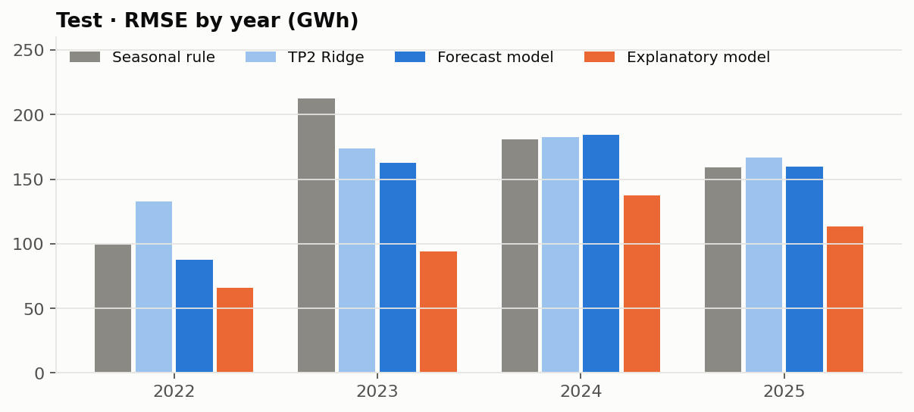
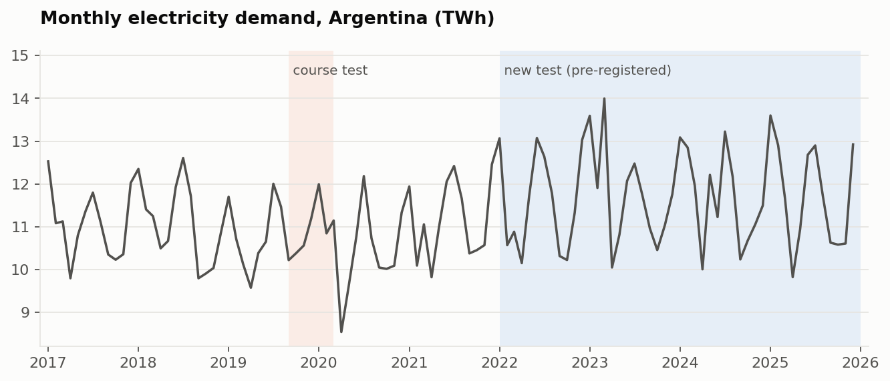

# Electricity demand in Argentina: when does a model beat "same month last year"?

[](https://github.com/alem123q/cammesa-demanda-app/actions/workflows/tests.yml)
&nbsp;·&nbsp; **Live app (Spanish):** https://cammesa-demanda-unraf.streamlit.app

Monthly electricity demand for Argentina's 9 wholesale-market regions (CAMMESA), 2017–2025.
The project started as coursework (regression, classification and clustering on 2017–2020) and continues as a
personal project that adds weather, economic activity and tariffs, extends the data to 2025, and tests the
conclusions on four years that were set aside before looking at them.

> 🇦🇷 **Resumen en español** al final.

## Key findings

| | Result |
|---|---|
| **Course (2019–20 test)** | No model beat the seasonal rule *same month last year*. The pre-registered Ridge: 76.7 GWh RMSE vs 71.0 for the rule. The validation ranking of six models was exactly reversed on the test. |
| **Exploration** | Modelling the year-over-year change with the month's actual weather cuts the error by 44 % (40.1 GWh). Using the *normal* weather instead loses the gain: the missing information was the weather itself. |
| **Why demand fell in 2018–19 (−6.4 %)** | About half weather (mild summers, warm 2019 winter), about a third recession and tariff increases together (tariffs act with a 6–12 month lag), the rest one-off cases. |
| **Pre-registered test, 2022–2025** | Explanatory model (actual weather and activity): **−37 %** RMSE vs the rule ✅. Forecast model (only information available in advance): **−9.1 %**, just short of the −10 % goal ❌. The course's Ridge: −1.9 %, a tie with the rule again. |

<p align="center"></p>

## The story in six notebooks

| Notebook | What it shows |
|---|---|
| [01 · Data](notebooks/01_data.ipynb) | Two CAMMESA sources joined into one series (9 regions × 108 months), checked on 14 overlapping months; weather, EMAE and tariff proxy |
| [02 · TP2 regression](notebooks/02_tp2_regression.ipynb) | Six regressors vs three rules on the course split; why validation did not predict the test |
| [03 · TP3 classification](notebooks/03_tp3_classification.ipynb) | Up or down vs last year: the class balance flips from 37 % to 85 % *up* |
| [04 · Clustering](notebooks/04_clustering.ipynb) | 868 agent series in three groups; region-months group by geography and season, not by direction |
| [05 · External drivers](notebooks/05_external_drivers.ipynb) | Weather, activity and tariffs on the course period; decomposition of the 2018–19 drop |
| [06 · Evaluation 2022–2025](notebooks/06_evaluation_2022_2025.ipynb) | The pre-registered test, opened once |

<p align="center"></p>

## How the evaluation was kept honest

- **Temporal splits only.** Every model is trained on the past and evaluated on later months; validation uses consecutive blocks inside the training period.
- **Pre-registration.** For both the course test and the 2022–2025 test, the model, metric and goal were written down before the test was opened. The [2022–2025 plan](docs/preregistro_2022_2025.md) is in the git history *before* the validation and test commits.
- **Results as they came out.** The forecasting goal was missed by 0.9 points and is reported as missed. Anything tried after seeing a test is labelled post-hoc.
- **Reproducible.** `pytest` checks that the pipeline still gives the course numbers (Ridge 76.7, rule 71.0, SVM 0.41 / 0.54, persistence 0.83); GitHub Actions runs it on every push.

## Reproduce

```bash
pip install -r requirements.txt -r requirements-dev.txt
python scripts/build_results.py          # course datasets, results and clusters from the raw file
python scripts/train.py                  # model used by the app
python scripts/build_extended.py         # 2017-2025 regional series from the annual reports
python scripts/evaluate_2022_2025.py --stage validation
python scripts/evaluate_2022_2025.py --stage test
pytest -q
streamlit run app.py
```

`scripts/download_external.py` re-downloads weather (Open-Meteo), EMAE and CPI (datos.gob.ar); the CSVs are already in `data/external/`.

## Repository

```
cammesa/            package: data loading, features, regression, classification, clustering,
                    exploration and the 2022-2025 evaluation
scripts/            command-line entry points (build, train, download, evaluate)
notebooks/          the analysis, executed
dashboard/          Streamlit app (UI in Spanish); app.py is the entry point
data/raw/           CAMMESA open-data file (2017-2020) and annual report databases (2019-2025)
data/external/      weather, EMAE and CPI
data/processed/     regional series and agent profiles
results/, models/   outputs read by the app and the notebooks
docs/               pre-registration and figures
tests/              reproduction tests
```

Code is in English; data columns keep the Spanish names of the CAMMESA files (`region`, `demanda_MWh`, `rezago_12`…).

## Data sources

- CAMMESA, *Demanda últimos años* — open-data portal, [datos.gob.ar/dataset/publicaciones-cammesa](https://datos.gob.ar/dataset/publicaciones-cammesa).
- CAMMESA, *Base de datos Informe Anual* 2020–2025 — cammesaweb.cammesa.com.
- Open-Meteo historical weather API (ERA5 reanalysis).
- INDEC, EMAE and regional CPI, via the datos.gob.ar time-series API.

## Credits

The 2017–2020 analysis (TP1–TP4) was done for *Aprendizaje Automático y Grandes Datos*, Computer Engineering,
Universidad Nacional de Rafaela (2026), by Francisco Alemandi, Eloy Kirov and Sebastián Palavecino.
The restructuring, the external variables, the 2017–2025 extension and the 2022–2025 evaluation are by
Francisco Alemandi.

---

## 🇦🇷 Resumen en español

Demanda eléctrica mensual de las 9 regiones de CAMMESA, 2017–2025.

- **En el trabajo de la materia** ningún modelo le ganó a la regla «mismo mes del año anterior».
- **Explorando**, apareció lo que faltaba: el clima del mes explica gran parte de lo que la regla no ve. La caída de 2018–2019 fue mitad clima y un tercio recesión y tarifas.
- **En una prueba pre-registrada sobre 2022–2025**, que nadie había mirado:
  - el modelo explicativo, con clima y actividad reales, tiene **37 % menos error** que la regla;
  - el modelo de pronóstico, con solo la información disponible de antemano, mejora **9,1 %**, apenas debajo de la meta de 10 %.

La aplicación está en español: https://cammesa-demanda-unraf.streamlit.app
